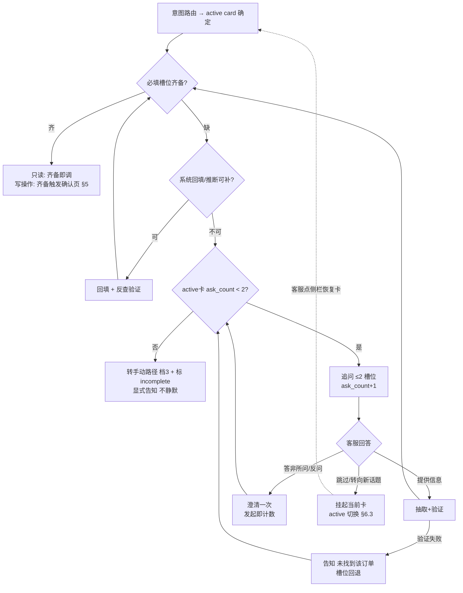

# 33 多轮对话与记忆管理（模块设计篇 D：C9 槽位补全 + M5 交互层纵深）

> **本文回答**：跨轮次的状态怎么记（短期记忆的对象与形态）、槽位怎么逐步抽取与验证、缺什么怎么追问、什么时候算"齐备"、齐备之后触发什么。
> **上游**：30-§4 D3（工具契约最小必填集）、14-§5.2（槽位补全成功率指标）、31-§3.3（M4 确认状态机）、29-§3.1/§3.2（L3 分级与输入侧拦截）、12-§2.2（追问可增量）、15-§2.1（C9 能力域）。**引用勘误（2026-10-29）**：追问 ≤2 轮规则为本文 D4 自定，原上游清单"14-§5.2（追问 ≤2 轮）"系误引——14-§5.2 是指标表，不是规则来源。
> **证据口径**：上线前决策记录稿。阈值无来源处标「推断」；本篇为 30-B 的纵深篇，**不重复 30-B 已定行为**（六节点、终止条件、工具契约），只展开"跨轮次"那一层。
> 决策状态：已冻结（2026-10-26）

## 前置偏离说明

| 模板纪律 | 本项目处理 |
|---|---|
| 21（流程与交互）模板要求"每角色流程 ≥3 + 跨端时序图 + 故事映射" | 本文以 **module-design 九段骨架**为主（对齐 30/31/32 篇式），**借用 21 的三条纪律**：失败分支必须画在图内（§4 流程图）、交互规则 ≥5 且带话术五层（§4.4）、数据闭环的写操作节点识别（§5）——C2（体验与信任）未成篇，话术五层采用模板蒸馏稿定义并按本项目实例化 |
| 21 模板"待验证假设 ≥3 移交 27" | 27（原型验证）未排入计划 → 移交 **26 评测体系**（§9），声明偏离 |
| 简历表述"全部齐备后触发调用" | **本项目语境下必须修正**：只读工具齐备即调；写操作齐备触发的是**预填快照 + 人工确认**，不是执行——见 §5.1，这是本篇第一优先讲清的事 |

---

## 0. 边界与分工（先说清本篇不做什么）

| 层 | 归属 | 一句话 |
|---|---|---|
| 一次请求怎么跑完（六节点、ReAct 终止、工具调用） | **30-B** | 已冻结，本文不重复 |
| 工具入参的最小必填集定义 | **30-§4 D3** | 本文消费它，不重定义 |
| 齐备后的单据确认/执行/哈希比对 | **31-§3.3** | 本文到"推送确认页"为止 |
| **跨轮次状态（短期记忆）、槽位抽取与验证、追问、上下文窗口、生命周期** | **本文（C9 + M5 交互层）** | 30-B 留白的部分 |

**一个必须先钉死的语境**：本产品的"用户"是**客服**，不是客户。多轮对话 = 客服与 Agent 在工作台内的多轮交互；客户在电话/聊天另一端。所以——**记忆记的是"客服在多轮里零散给出的信息"，追问的对象是客服，语气是协作不是审问**。副驾的克制优先于表单的完整：最好的槽位管理是客服感觉不到槽位管理（§4.3 边界 8）。

---

## 1. 记忆的对象：结构化会话状态，不是自由文本

**决策 D1·短期记忆 = 结构化 SessionState 对象**

```
SessionState {
  session_id, agent_id(客服工号), created_at, last_active_at
  platform_ctx          // 推断的平台（淘宝/京东/抖店），会话入口确定
  active_card           // 当前聚焦任务卡（TaskCard | null）
  suspended_cards[]     // 挂起卡（话题切换时保留，§6.3）
  cards {               // 按 card_id 命名空间隔离（§6.3）
    card_id → {
      slots {
        slot_name → { value, source, verified, ts, history[] }
        // source ∈ extracted(对话抽取) / inferred(上下文推断)
        //         / system(系统回填) / form(确认页填写)
        // verified: 正则+系统反查通过（§3）
      }
      ask_count         // 每卡独立追问计数（≤2，§4.2）——挂起不丢
    }
  }
  turn_count            // 会话总轮次
}
```

**正反走查例（一句话钉死"记什么"）**：客服说"8012 那单客户说没收到货"——进槽：`order_id=8012`（抽取 → 反查验证）；"没收到货"是任务线索（T2 物流/T4 退款原因素材），进意图与原因槽；**"客户说"的转述内容不进任何槽位**——它留在对话原文滑窗里。纪律：**槽位是工具入参候选，不是对话要点摘要**。记忆里存的是"客服说过什么"（结构化、带来源），不是"订单是什么"（永远以平台实时接口为准，31-§3.2）。

- **被杀备选：自由文本记忆（把历史对话摘要成一段"记忆"喂给模型）**——三个理由：① **不可审计**：承诺 9 要求"错了能追"，一段模糊摘要无法回答"你当时记的订单号是什么"；② **抽取不稳定**：摘要再喂模型等于二次抽取，误差叠加；③ **值的历史会丢**（客服改口时旧值消失，无法解释"为什么从 A 改成 B"）。结构化状态每个值都有来源与时间戳，审计与撤销都机械化。
- **为什么这不是"又造一个数据库"**：SessionState 是**会话级临时对象**（内存 + 每次迁移落 PG 审计），不承载业务事实——订单事实永远以平台接口实时返回为准（31-§3.2 不缓存订单状态）。

### 1.1 横向选型：为什么不用现成的记忆轮子（面试必问，正面回答）

| 候选 | 是什么 | 为什么不用 |
|---|---|---|
| **LangGraph checkpointer** | 执行图状态的快照机制，解决"断点回放/时间旅行" | 它解决的是**执行态**持久化，不解决业务语义——槽位来源、验证、时效、每卡计数这些规则它一概不管。且编排载体在 25-§2.2 D4 尚未终判（自研 vs LangGraph 由 POC-4 定）：**SessionState 刻意设计为编排无关的外部 store**（内存 + PG 审计）——选自研它直接用；选 LangGraph，checkpointer 快照图执行态、SessionState 仍是业务态，**两者是层不是竞争** |
| **Mem0 / LangMem 类记忆系统** | 跨会话长期记忆（偏好/事实沉淀/检索） | 定位是**跨会话**——直接撞 05-§6.2 非目标与 29 数据最小化（§6.4 边界宣言）。本项目"记忆"语义止于会话，引入它是给不存在的需求付数据留存与边界审查的代价 |
| **自研 SessionState** | 会话级强类型状态对象 | **选定**。决定性理由：记忆对象由 30-§4 D3 工具契约的**最小必填集**决定——业务强类型，通用 memory 层是错位抽象。实现量级 ~200 行状态对象 + 迁移审计（推断），不是"造了个数据库" |

---

## 2. 槽位模型：五卡必填集 × 三类来源

### 2.1 槽位表（消费 30-§4 D3 契约的最小必填集）

| 卡 | 必填槽位 | 主来源 | 追问？ | 说明 |
|---|---|---|---|---|
| T2 物流查询 | order_id | 抽取/系统回填 | ✅ | platform 从 `platform_ctx` 推断，失败追问（30-§4 D3 `query_order_logistics` 行注） |
| T1 成分功效 | sku_or_name + 问题 | 抽取 | 极少 | 首轮提问通常自带，追问是兜底 |
| T1 扩展·活动查询 | sku_id + date | sku_id 抽取/system 回填；**date 默认今日推断** | 极少 | 对应 30-§4 D3 `get_promotion_terms`（只读，齐备即调）——多数会话 date 无需追问 |
| T5 制度流程 | 主题 | 抽取 | 极少 | 同上 |
| T3 地址变更 | order_id、reason | 抽取 | ✅ | **new_address 是 form 槽位：确认页填写，结构性不进对话、不追问**（29-§3.1：L3 明文不进模型上下文） |
| T4 退款申请 | order_id、reason_code(枚举) | 抽取 | ✅ | **evidence：来源 = extracted/附件引用，验证 = 存在性检查（非空即可，不反查内容）**；G3b 开启后才可达此卡（12-D8） |

### 2.2 槽位来源三分法（决策 D2）

| 来源 | 语义 | 例子 |
|---|---|---|
| **extracted** | 从客服对话文本中抽取 | "帮我查一下订单 8012" → order_id=8012 |
| **inferred / system** | 从会话上下文推断或系统回填 | platform 从会话入口推断；当前会话关联的最近订单回填候选 |
| **form** | 确认页表单填写 | new_address——**L3 字段结构性不进对话槽位** |

**这条分法是记忆设计服从隐私分级的直接体现**：SessionState 里结构性不存在 L3 字段位——form 槽位在状态里只有 `form_completed: true` 标志，值本体在确认页组件中**塔内瞬态存在、任务终结即删**（29-§3.1：不落地、不进日志；05-附录 B B-5）。**"记忆"再方便，也不给 L3 开后门**。

---

## 3. 抽取与验证：抽出来的不算数，验证过才算

**决策 D3·可验证的槽位必须验证（双通道）**

```
抽取 → 通道一：模型抽取（带置信度）
     → 通道二：机械校验
         ├─ 格式校验：订单号位数/字符集正则（防模型幻觉数字）
         └─ 系统反查：调只读接口确认订单存在、属于本店铺、属于当前会话上下文
     → 双通道通过 → verified=true 入槽
     → 任一失败 → 槽位回退"待追问"，并告知客服"没找到这个订单号，请确认"
```

- **为什么必须反查**：抽取错误若流入预填，错误会**伪装成"客服自己确认过的"**——因为确认页展示的是错单号，客服一眼扫过就签了。反查把错误拦截在预填之前。这对应 26 事实门的精神：**不信任未验证的中间产物**。
- **反查的时延代价**：order_id 反查 ≤500ms（只读接口，计入 31-§3.1 检索预算之外的工具段——推断）。只在"订单号首次入槽"时反查一次，不重复查。
- **`verified` 有时效**（§6.1 边界 7）：会话 idle 超 30 分钟后恢复，verified 槽位降级为 unverified 并重校验——**订单状态会变，30 分钟前的"验证通过"不代表现在**。重校验是**懒触发**：客服回来后不立即全量重查（避免先等一批接口调用），该槽位被下一次预填/调用**消费前**重查，重查时延计入该次调用预算（推断 +300ms）。

---

## 4. 抽取时机、追问策略与话术

### 4.1 抽取时机（不扫描，顺路抽取）

抽取跑在 ② 意图识别节点的下游：**只对 active card 相关的轮次做槽位抽取**，不做全槽位扫描。客服陈述里出现非当前卡的实体（提到另一个订单号）→ 存入 `suspended` 候选池不激活——**副驾不抢话**。

### 4.2 追问策略（决策 D4）

| 规则 | 内容 | 理由 |
|---|---|---|
| **触发顺序** | 系统回填 → 上下文推断 → 最后才追问 | 追问是**兜底**不是流程；能自己解决的打断都是浪费 |
| **打包上限** | 一次追问 ≤2 个槽位 | 客服在工作，不是在填表；一次问三件事等于逼他切屏找信息 |
| **总轮次上限** | 每卡 ask_count ≤2（33-D4），**追问发起即计数**（无论回答质量，防死循环） | 超限 → 显式转手动路径（档 3）+ 状态标 incomplete，**不静默放弃**（承诺 8） |
| **作用域** | 只对 active card 追问 | 不做"全槽位扫描式追问"——那是机器人行为 |
| **问法** | 具体到槽位："这单是淘宝还是京东的？"（platform 二选一）；**禁止**"还缺少一些信息，请补充" | 模糊追问 = 逼客服反问"缺什么"，净增一轮 |

### 4.3 追问闭环流程（失败分支在图内）



> 图的守卫纪律：**任何进入追问的路径都必须先过 E（ask_count < 2）**——澄清也是一次追问发起，同样计数，图上不存在绕过守卫的边；挂起卡的恢复复用入口 A（重新判定齐备），ask_count 随卡保留不重置。

### 4.4 追问话术五层（交互规则，模板纪律：不截层）

| 层 | 追问场景实例（缺 platform） |
|---|---|
| 事实 | "还差一个信息：这单是哪个平台的？" |
| 解释 | "不同平台物流接口不同，说错了查不到。" |
| 情绪回应 | （不指责："是我没问清楚"姿态；**不出现**"您刚才没说"） |
| 行动建议 | "或者直接把订单链接贴给我也行。" |
| 系统告知 | "不想找的话，我给你淘宝后台的手动查询路径。" |

**交互规则汇总（≥5）**：① 追问只针对 active card；② 一次 ≤2 槽位；③ 总 ≤2 轮、发起即计数；④ 问法必须具体到槽位选项；⑤ 话术五层完整（上方）；⑥ 客服改口必须显式确认（"已更新为 XX"，§6.1 边界 3）；⑦ 齐备后新信息不自动进已生成快照（§6.1 边界 4）；⑧ 追问界面常驻"跳过，给手动路径"入口（客服永远有退出权）。

**第二实例（缺 order_id，证明五层不是单槽位凑巧）**：事实"查物流的话给我个订单号"／解释"同店铺一天几百单，没单号我定位不到是哪单"／情绪（不指责，姿态同上）／行动"右侧订单列表可以直接复制单号"／告知"或者用客户姓名+手机后四位在平台后台搜，我把路径给你"。

---

## 5. 齐备判定与触发（本文与简历表述对齐的关键节）

### 5.1 触发分野：只读即调，写操作齐备 ≠ 执行（决策 D5 前提）

| 类型 | 齐备后动作 | 确认环节 |
|---|---|---|
| **只读工具**（T2 物流/T1 检索/活动查询） | **齐备即调**——order_id 验证通过 + platform 推断成功 → 直接查 | 无需确认（读操作，29-L3 不管只读） |
| **写操作**（T3/T4） | **对话槽位齐备（order_id、reason 等）→ 推送确认页（含 form 区）→ 客服填写 form 槽位（new_address 等）→ 此时全部必填集齐备 → 调 `prefill_address_change`（new_address_ref 为填写引用，非明文）→ 生成快照 H1 → 待确认（TTL 24h，31-§3.3）→ 客服确认 → 哈希 H2==H1 → R7 执行** | **必须**：确认签名绑定快照哈希（29-§2.1 L3 三要素）——**form 填写在快照生成之前**，否则 H2==H1 恒失败 |

> **简历表述的修正（面试防线）**："全部齐备后触发调用"在本产品的准确说法是——**只读调用齐备即调；写操作齐备触发的是预填，执行永远隔着人工确认（29-L3 三要素）**。面试官若问"所以 agent 直接改地址了？"，答案是否定的：agent 推进到"可确认"状态，这正是 05-§3.4「办得成 = 推进到可办结」的定义。把这句说对，比把功能说得更自动更加分。

### 5.2 齐备判定 = 纯规则（决策 D5）

"必填集是否齐备"由**机械规则**判定，**模型不参与这个判断**：

```
ready(card) = ∀ s ∈ card.必填集:
    slot[s].value 存在
    && ( slot[s].verified || slot[s].source == form )
    && now − slot[s].ts < TTL_verified(30min；超期先懒重查，§3)
    // form 槽位：value 不可见，仅检查 form_completed 标志
```

理由：① 可审计——任何一次"为什么触发了预填"都能用规则复现；② 可测试——26 快层可以直接断言"缺 X 时不得触发"；③ 若让模型判齐备，等于把 30-B 用最小必填集关上的"模型猜"后门又开了一半。

---

## 6. 上下文窗口与生命周期

### 6.1 边界条件（八条，每条给机械处理）

| # | 边界 | 处理 |
|---|---|---|
| 1 | **客服粘贴客户消息**（可能含 L3 明文） | 输入侧实时脱敏（29-§3.2 ②-b），抽取跑在**脱敏后文本**上——原始输入不落日志 |
| 2 | 订单号反查失败（不存在/非本店铺） | 槽位回退待追问 + 告知客服；**连续 2 次失败 → 提示可能贴错窗口，建议直接贴订单链接** |
| 3 | **客服改口**（"不对，是 8013 那单"） | 新值覆盖旧值**必须显式**：更新槽位 + 返回"已更新为 8013"确认条；旧值进 `history[]` 不丢弃（审计 + 可解释） |
| 4 | **齐备后客服补充新信息** | pending 快照已生成 → 新信息**不自动进快照**（快照冻结，哈希语义）；需变更 → 客服显式选择"重新预填"→ 生成新快照 H1′（31-§3.3 修改路径），不作静默替换 |
| 5 | 追问 2 轮未齐 | 转手动路径（档 3）+ incomplete 标记进 Badcase——**归因挂 ④ 路由节点子标签"槽位缺失"**（维度集不变：六节点 + 知识条目，不新开维度，26-G5 口径） |
| 6 | 复合意图拆卡后一卡先齐备 | 只触发该卡，**不互相等待**（T3 的槽位齐了就走 T3，不等 T5） |
| 7 | **idle 恢复后时效** | verified 槽位降级懒重校验（§3）；pending 任务按 31-§3.3 的 TTL 24h 独立计时 |
| 8 | **单轮齐备**（"改地址，订单 8012，原因搬家"） | 零追问直通确认页——**追问是兜底不是流程**，这是对"副驾克制"的正向表述 |
| 9 | **客服粘贴超长文本**（>2000 字） | 输入侧**先脱敏再截断**（29-§3.2 前置）：保留前 2000 字 + 提示"内容过长已截断，关键信息请单独发送"；抽取跑在截断后文本上 |
| 10 | **会话被强制关闭**（管理员操作/客服账号停用） | 视同会话结束（§6.4 归档，审计保留 90 天）；**pending 任务不随会话消失**——按自身 TTL 24h 独立存活，无人确认即超时作废（**不转移、不自动执行**——确认权不可继承，29-L3） |

### 6.2 上下文窗口管理（决策 D6）

**原则：状态注入优先于历史粘贴。** 每轮给模型的上下文 =

```
system prompt（含 L3 禁令） 
+ SessionState 紧凑序列化（active 卡 + 挂起卡名 + 槽位四元组）
+ 最近 K 轮原文（K=6，推断）
+ 当前卡挂载的工具 schema（按需，30-§4 D5）
```

- **token 预算**：总上下文 ≤8K（推断）——给 5s 时延承诺留出生成空间。**分块估算（可复算的依据，均推断）**：

| 块 | 估算 | 说明 |
|---|---|---|
| system prompt + L3 禁令 | ~800 | 固定 |
| SessionState 紧凑序列化 | ~300–800 | 随卡数与槽位 history 长度涨 |
| 最近 K=6 轮原文 | ~2,400–4,800 | 每轮均 400–800 token（客服输入 + 工具结果摘要） |
| 工具 schema（active 卡挂载） | ~500–1,000 | 2–4 个工具（30-§4 D5 按需加载） |
| **合计** | **≈4.0–7.6K** | 预算内；超限走裁剪序 |

  **K=6 的依据**：客服改口与槽位引用集中在最近 2–3 轮（灰度期操作日志校准）；更早的信息已经进 SessionState——**被裁掉的原文不承载唯一事实**，状态注入兜底。超限**裁剪顺序**：① 最旧轮次转摘要 → ② 挂起卡只留卡名与已齐槽位数 → ③ 工具 schema 只留 active card 的。**不裁**：L3 禁令、active 卡槽位、最近 2 轮。
- **为什么不用全历史**：客服会话 20+ 轮常见——全历史 = token 成本线性涨 + **旧值噪音**（客服改口前的旧订单号会被反复抽出来）。滑窗 + 状态注入让"当前有效值"只有一个来源。
- **并发会话**：session_id 隔离（30-§6.1 边界 4），单客服并发 ≤3，各自独立 SessionState，互不串值。

### 6.3 话题切换与多卡并行（决策 D8）

- 客服在 T3 进行中插入新问题 → 当前卡**挂起**（槽位与 ask_count 保留），新卡激活或直接只读回答；
- 客服说"先处理退款" → active 切换，挂起卡在工作台侧栏显示状态（"地址变更 · 缺新地址"草稿感）；
- **防串值**：槽位按 card_id 命名空间隔离；两张卡同订单时由**系统回填并标注来源**，不允许模型跨卡复制槽位值（复制即可能把 A 卡的 reason 粘到 B 卡）。

### 6.4 生命周期（决策 D7）

| 阶段 | 规则 |
|---|---|
| 会话内 | 状态实时更新；**每次状态迁移写审计**（承诺 9：90 天可回溯） |
| idle | 30 分钟无活跃（推断）→ 状态快照落盘，会话转 idle；客服回来 → 恢复 + verified 时效重校验（§6.1 边界 7） |
| 会话结束 | SessionState 转归档（审计 90 天）；**"记忆"语义止于会话**——归档不可被新会话召回（V1 不做跨会话记忆/客服画像，05-§6.2 非目标） |
| pending 任务 | TTL 24h（31-§3.3），超时作废并通知；槽位快照随任务存档 |

> **"短期记忆"的边界宣言（面试必答）**：本产品的记忆 = 会话级结构化状态 + 会话级追问增量（12-§2.2 任务样本 7），**不做**跨会话记忆、客服画像、长期偏好学习——不是能力不够，是 05-§6.2 非目标与 29 数据最小化的主动选择。跨会话"记住"客服习惯，收益是少问一次平台名，代价是又一条需要边界审查的数据留存——不换。

### 6.5 降级路径汇总与产品层主要风险

| 主路径 | 降级路径 | 用户控制保留 |
|---|---|---|
| 自动抽取 + 验证 | 抽取/验证失败 → 追问（≤2 轮守卫内） | 客服可说"忽略刚才那条"，槽位回退 |
| 追问补全 | 2 轮未齐 → 手动路径（档 3）+ incomplete 进 Badcase | 常驻"跳过"入口（规则 ⑧） |
| 状态注入上下文 | 超预算 → 裁剪序（§6.2） | – |
| pending 快照 | 客服取消 → cancelled（不自动作废，31-§3.3）；无人确认 → TTL 24h 作废 | 客服全程手动 |
| idle 恢复 | 状态重建失败 → 重新抽取（等同新会话起步，不静默丢） | – |

**产品层主要风险（对位 30-§6.3 写法）**：**追问设计的最大风险不是技术是克制**。追问太勤，客服会把 Agent 当表单机绕开——覆盖率掉，G4 不达标，且这种流失在会话日志里表现为"沉默"而不是"抱怨"，不易察觉。度量挂 §9.2 的"追问打断率"反指标，灰度期按会话类型分桶观测。第二个风险：SessionState 成为"第二个事实源"——纪律已写死（§1：订单事实以平台实时接口为准，记忆只记客服说过什么），但要在 M8 归因里持续盯"状态与平台不一致"类错答，出现即说明边界被 implementation 破坏。

---

## 7. 接口与权限落点

| 项 | 来源/落点 |
|---|---|
| 槽位状态读写 | M5 编排层内部对象；**每次迁移写审计**（30-§4 埋点 + 承诺 9） |
| 追问消息 | 走会话通道，带 `type=slot_ask` 标记——评测可独立统计追问轮次（14-§5.2 槽位补全成功率的分母来源） |
| 反查验证 | 只读接口 `query_order_logistics` 复用（30-§4 D3），不新增写权限 |
| form 槽位 | 确认页组件（31-§3.3），值不经模型、不进 SessionState、不进日志 |
| 权限 | 无新增角色/权限——C9 是 M5 内部能力，权限语义全部继承 29-§1.1 |

---

## 8. 本模块的决策输出

| 编号 | 决策 | 被杀备选（理由） | 重议信号 |
|---|---|---|---|
| D1 | 短期记忆 = 结构化 SessionState | 自由文本记忆摘要（不可审计/二次抽取误差/丢值历史） | 归因显示"状态字段缺失"类 Badcase >10% → 重审字段集 |
| D2 | 槽位三来源（extracted/inferred+system/form） | 单一"对话抽取"来源（L3 无处安放，追问必然越界问地址） | 无（L3 约束不可重议） |
| D3 | 可验证槽位必须双通道验证 | 抽取即入槽（错误流入预填，伪装成已确认） | 反查失败率 >5% → 校验规则或正则复审 |
| D4 | 追问：系统回填优先、≤2 槽位/轮、总 ≤2 轮、仅 active card | 每缺必问（打断成本）、全历史扫描式追问（机器人行为） | 槽位补全成功率（14-§5.2）<60% 且首轮齐备率低 → 追问时机/打包复审 |
| D5 | 齐备判定 = 纯规则，触发分野：只读即调 / 写操作齐备→预填 | 模型判断齐备（不可审计）；写操作齐备即执行（撞 29-L3 红线） | 无（红线不可重议；规则误触发由 Badcase 驱动修规则） |
| D6 | 上下文 = 状态注入 + K=6 滑窗，预算 ≤8K | 全历史注入（token 涨 + 旧值噪音 + 改口反复抽取） | 抽取错误中"旧值残留"占比 >20% → 缩 K 或提前摘要 |
| D7 | 生命周期：idle TTL 30min / pending 24h / 归档 90 天 / 记忆止于会话 | 跨会话记忆（撞 05 非目标与数据最小化） | 灰度期"idle 恢复后前 2 轮内客服重述已给信息"比例 >30%（推断阈值）→ 评估"同客服当日会话显式关联"（仍非记忆，是显式关联） |
| D8 | 多卡并行：命名空间隔离 + 聚焦切换 + 系统回填关联 | 跨卡共享同名字段（串值风险） | 复合意图场景槽位串值 = 0 为硬验收，出现即回审隔离 |

---

## 9. 验收与反指标

### 9.1 验收（G2 期间实测，阈值标推断）

| # | 项 | 判据 | 上游 |
|---|---|---|---|
| 1 | 槽位补全成功率 | 一次追问即齐备 ÷ 需补全 **≥70%（推断）**；按月报，样本量小如实标注（14-§5.2：仅地址/退款场景） | 14 |
| 2 | 单轮齐备率 | 零追问完成的比例（越高越好，副产品是追问指标的天花板） | 本篇 §6.1-8 |
| 3 | 抽取验证 | verified 槽位在预填前失效数 = 0（反查+时效双重保险下仍漏 → 缺陷） | 本篇 §3 |
| 4 | 齐备判定 | 快层断言：缺任一必填槽位时**不得触发预填**（规则可测性直接落断言） | 26 快层 |
| 5 | 上下文预算 | 会话 token P95 ≤8K；裁剪触发率 ≤10% | 本篇 §6.2 |
| 6 | 多卡隔离 | 复合意图评测集中槽位串值 = 0 | 12-G2 复合判据 |
| 7 | 追问上限 | ask_count >2 的卡 = 0（状态机强制） | 33-D4 |

### 9.2 反指标（成对看，防止指标被优化歪）

| 正指标 | 反指标 | 为什么成对 |
|---|---|---|
| 补全成功率 ↑ | **追问打断率 ↑**（追问次数/会话） | 网问得勤=成功率高，但客服被打断的成本没算 |
| 单轮齐备率 ↑ | **重新预填率 ↑** | 齐得快但信息错，后面返工更多 |
| token 预算达标 | **裁剪后状态丢失**（摘要化轮次里被再次引用的槽位数） | 预算达标靠过度裁剪 = 假达标 |
| 追问轮次 ≤2 达标 | incomplete 转人工率 ↑ | 轮次上限卡死 = 该转的不转变成硬放弃 |

---

## 10. 开放问题与移交

| # | 事项 | 移交 | 时点 |
|---|---|---|---|
| 1 | C9 触发时机的阈值（哪些槽位缺失才值得打断） | 26 评测（30-§8 开放问题 1 已登记，本篇补齐观测字段：`type=slot_ask`） | G2 标注集建成后 |
| 2 | K=6 与 ≤8K 预算的实测校准 | POC-1 同期压测（25-§3.1） | W4 前后 |
| 3 | idle TTL 30min 的合理性（客服真实工作节奏） | 灰度期操作日志 | 12-G4 灰度 |
| 4 | "同客服当日会话显式关联"是否值得做（跨会话记忆的替代形态，仍非记忆） | 15 版本规划（V1.5 候选，不进 V1） | V1.5 评估 |
| 5 | 场景卡：追问闭环需新增 1 张卡（S-11 追问超限转手动） | 26（安全卡第 5 张之外的补充） | 26 场景卡扩编时 |

---
> 冻结：2026-10-26（freeze.sh）
